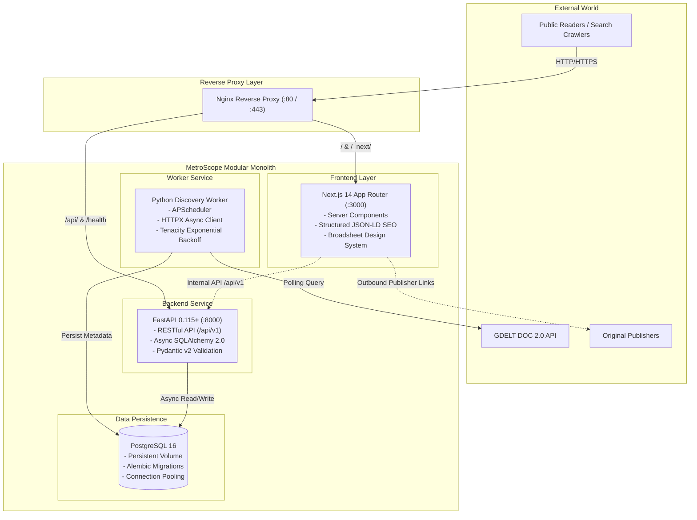

# MetroScope Architecture Overview

## 1. System Vision

MetroScope is an automated, US-focused global news aggregation and distribution platform designed to:
1. Discover high-frequency news metadata from the GDELT DOC 2.0 API.
2. Ingest, deduplicate, and normalize article records into PostgreSQL.
3. Expose an editorial, high-performance, SEO-optimized web experience built with Next.js and Tailwind CSS.
4. Prepare clean integration points for automated distribution to social channels (Facebook Pages and X) in future phases.

## 2. Architectural Diagram

## 3. Memory-Constrained Design Strategy (AWS EC2 t3.small: 2 vCPU, 2 GB RAM)

To achieve enterprise-grade reliability within a 2 GB RAM envelope without risking out-of-memory (OOM) failures:

1. **Elimination of Unnecessary Middleware:**
   - No Redis, Celery, RabbitMQ, Elasticsearch, or Kubernetes in this phase.
   - Background tasks are driven directly by APScheduler running in a lightweight Python worker container.

2. **Conservative Database Pooling:**
   - PostgreSQL connections are restricted to `pool_size=5` and `max_overflow=5` in SQLAlchemy async engine settings.
   - Database health checks run lightweight `SELECT 1` queries without holding open idle connections.

3. **Multi-Stage Container Optimization:**
   - The Next.js frontend uses `output: 'standalone'`, bundling only necessary node_modules into a minimal Alpine container (~100MB RAM footprint).
   - Heavy Next.js compilation runs in GitHub Actions CI, never on the production host.
   - The FastAPI backend runs on `python:3.11-slim` with compiled wheels and non-root execution.

## 4. News Discovery & Publisher Copyright Compliance

MetroScope strictly respects intellectual property and GDELT terms of service:
- **Discovery Only:** We query article titles, canonical URLs, publication timestamps, and source domains.
- **Attribution First:** All article details pages feature explicit attribution notices, publisher badges, and direct canonical links to the original publisher.
- **No Unauthorized Scrapes:** Full body texts and copyright-protected photos are not scraped, republished, or monetized.

## 5. Security & Reliability

- **No Hardcoded Secrets:** All credentials, keys, and connection strings are injected via environment variables.
- **Sanitized Health Checks:** Health check endpoints (`/health` and `/api/v1/health`) report connectivity status without leaking database URLs or passwords.
- **Centralized Exception Handling:** Unhandled errors are caught, logged with structured context, and returned to clients as uniform JSON payloads without stack traces.
