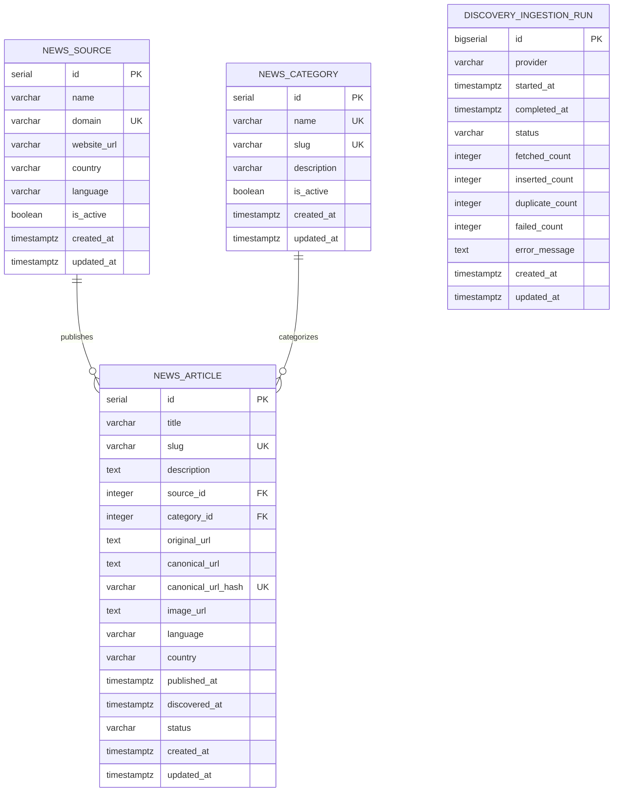

# MetroScope Database Schema Documentation

**Version:** 1.0.0 (Phase 2)  
**RDBMS:** PostgreSQL 16+ / SQLAlchemy 2.0 Async  
**Migration Engine:** Alembic  
**Target Environment:** AWS EC2 `t3.small` (2 vCPU, 2 GB RAM)  

---

## 1. Entity Relationship Diagram (ERD)

---

## 2. Table Specifications

### 2.1. `news_sources`
Stores verified journalistic publishers and news media domains discovered by the platform.

| Column | Data Type | Nullable | Default | Constraints & Indexes | Description |
|---|---|---|---|---|---|
| `id` | `SERIAL` | No | Auto | `PRIMARY KEY` | Unique internal identifier |
| `name` | `VARCHAR(255)` | No | None | None | Clean human-readable publisher name |
| `domain` | `VARCHAR(255)` | No | None | `UNIQUE`, `ix_news_sources_domain` | Lowercase normalized publisher domain (e.g. `reuters.com`) |
| `website_url` | `VARCHAR(1024)` | Yes | `NULL` | None | Primary publisher homepage URL |
| `country` | `VARCHAR(10)` | No | `'US'` | `ix_news_sources_country` | ISO country code |
| `language` | `VARCHAR(10)` | No | `'en'` | None | ISO primary language code |
| `is_active` | `BOOLEAN` | No | `TRUE` | `ix_news_sources_is_active` | Whether discovery from this source is active |
| `created_at` | `TIMESTAMPTZ` | No | `now()` | None | Creation timestamp in UTC |
| `updated_at` | `TIMESTAMPTZ` | No | `now()` | None | Modification timestamp in UTC |

### 2.2. `news_categories`
Editorial news taxonomy providing standard categorization across discovered dispatches.

| Column | Data Type | Nullable | Default | Constraints & Indexes | Description |
|---|---|---|---|---|---|
| `id` | `SERIAL` | No | Auto | `PRIMARY KEY` | Unique category identifier |
| `name` | `VARCHAR(100)` | No | None | `UNIQUE` | Editorial category display name (e.g. `Technology`) |
| `slug` | `VARCHAR(100)` | No | None | `UNIQUE`, `ix_news_categories_slug` | URL-safe category identifier (e.g. `technology`) |
| `description` | `VARCHAR(500)` | Yes | `NULL` | None | Editorial desk summary description |
| `is_active` | `BOOLEAN` | No | `TRUE` | `ix_news_categories_is_active` | Active category display flag |
| `created_at` | `TIMESTAMPTZ` | No | `now()` | None | Creation timestamp in UTC |
| `updated_at` | `TIMESTAMPTZ` | No | `now()` | None | Modification timestamp in UTC |

### 2.3. `news_articles`
Normalized news discovery records indexed from GDELT DOC 2.0 API. Strictly contains public metadata, factual summaries, and publisher links. Does **not** store scraped publisher article bodies.

| Column | Data Type | Nullable | Default | Constraints & Indexes | Description |
|---|---|---|---|---|---|
| `id` | `SERIAL` | No | Auto | `PRIMARY KEY` | Unique article record identifier |
| `title` | `VARCHAR(512)` | No | None | `ix_news_articles_title` | Sanitized headline title (HTML unescaped, branding suffix stripped) |
| `slug` | `VARCHAR(600)` | No | None | `UNIQUE`, `ix_news_articles_slug` | URL-safe slug with unique timestamp-hash salt |
| `description` | `TEXT` | Yes | `NULL` | None | Brief discovery snippet / permitted summary |
| `source_id` | `INTEGER` | Yes | `NULL` | `FOREIGN KEY (news_sources.id) ON DELETE SET NULL`, `ix_news_articles_source_id` | Associated publisher record |
| `category_id` | `INTEGER` | Yes | `NULL` | `FOREIGN KEY (news_categories.id) ON DELETE SET NULL`, `ix_news_articles_category_id` | Editorial news category |
| `original_url` | `TEXT` | No | None | None | Exact raw URL returned by GDELT upstream |
| `canonical_url` | `TEXT` | No | None | None | Normalized, tracking-stripped canonical URL |
| `canonical_url_hash` | `VARCHAR(64)` | No | None | `UNIQUE`, `ix_news_articles_canonical_url_hash` | SHA-256 hex digest of `canonical_url` for $O(1)$ deduplication |
| `image_url` | `TEXT` | Yes | `NULL` | None | Permitted discovery lead image thumbnail URL (if licensed/authorized) |
| `language` | `VARCHAR(10)` | No | `'en'` | None | ISO language code |
| `country` | `VARCHAR(10)` | No | `'US'` | `ix_news_articles_country` | Discovered country origin |
| `published_at` | `TIMESTAMPTZ` | No | None | `ix_news_articles_published_at` | Publication timestamp parsed from GDELT `seendate` |
| `discovered_at` | `TIMESTAMPTZ` | No | `now()` | `ix_news_articles_discovered_at` | Record ingestion timestamp |
| `status` | `VARCHAR(20)` | No | `'published'` | `ix_news_articles_status` | Status: `published`, `archived`, `flagged` |
| `created_at` | `TIMESTAMPTZ` | No | `now()` | None | System creation timestamp |
| `updated_at` | `TIMESTAMPTZ` | No | `now()` | None | System update timestamp |

**Composite Indexes:**
- `ix_news_articles_category_published`: `(category_id, published_at DESC)` — Optimizes category feed queries.
- `ix_news_articles_status_published`: `(status, published_at DESC)` — Optimizes front page wire feed and search pagination.

### 2.4. `discovery_ingestion_runs`
Audit and operational telemetry tracking every execution of the news ingestion worker.

| Column | Data Type | Nullable | Default | Constraints & Indexes | Description |
|---|---|---|---|---|---|
| `id` | `SERIAL` | No | Auto | `PRIMARY KEY` | Ingestion cycle run identifier |
| `provider` | `VARCHAR(50)` | No | `'gdelt'` | `ix_discovery_ingestion_runs_provider` | Ingestion provider identifier |
| `started_at` | `TIMESTAMPTZ` | No | `now()` | None | Job execution commencement time |
| `completed_at` | `TIMESTAMPTZ` | Yes | `NULL` | None | Job completion time |
| `status` | `VARCHAR(20)` | No | `'running'` | `ix_discovery_ingestion_runs_status` | Execution status: `running`, `success`, `partial`, `failed` |
| `fetched_count` | `INTEGER` | No | `0` | None | Number of candidate records retrieved from GDELT |
| `inserted_count` | `INTEGER` | No | `0` | None | Number of new distinct articles written to database |
| `duplicate_count` | `INTEGER` | No | `0` | None | Number of duplicate articles detected and skipped |
| `failed_count` | `INTEGER` | No | `0` | None | Number of candidate items that failed normalization |
| `error_message` | `TEXT` | Yes | `NULL` | None | Detailed error log if failure occurred |
| `created_at` | `TIMESTAMPTZ` | No | `now()` | None | Record creation timestamp |
| `updated_at` | `TIMESTAMPTZ` | No | `now()` | None | Record update timestamp |

---

## 3. Seeded News Categories

The schema includes 10 seeded editorial news categories matching MetroScope's broadsheet taxonomy:

| Name | Slug | Description |
|---|---|---|
| **World** | `world` | Global events, international relations, and diplomatic affairs |
| **US** | `us` | Domestic American reporting, state policies, and national affairs |
| **Politics** | `politics` | Elections, governance, legislation, and political analysis |
| **Business** | `business` | Corporate updates, macroeconomics, finance, and trade |
| **Technology** | `technology` | Artificial intelligence, computing, software, and cybersecurity |
| **Science** | `science` | Space exploration, scientific breakthroughs, and academic research |
| **Health** | `health` | Medicine, public health policy, and healthcare innovations |
| **Environment** | `environment` | Climate science, renewable energy, and ecological developments |
| **Sports** | `sports` | Major league athletics, championships, and athletic reporting |
| **Entertainment** | `entertainment` | Film, arts, culture, media, and digital creators |

---

## 4. Resource & Retention Design for 2 GB RAM Server

On an AWS EC2 `t3.small` instance (2 GB RAM, 384 MB allocated to PostgreSQL container):

1. **Connection Pooling:** SQLAlchemy configured with `pool_size=5` and `max_overflow=5` (max 10 connections). This keeps PostgreSQL RAM utilization below 80 MB.
2. **Indexing Footprint:** B-tree indexes are limited to high-cardinality lookups (`slug`, `canonical_url_hash`, `published_at`). SHA-256 hash index is compact (64 bytes per record), requiring less than 8 MB of index cache per 100,000 articles.
3. **Retention & Archival Strategy:** Ingestion logs older than 90 days can be pruned via `DELETE FROM discovery_ingestion_runs WHERE started_at < NOW() - INTERVAL '90 days'`. Inactive articles older than 180 days can be archived without table locks.
