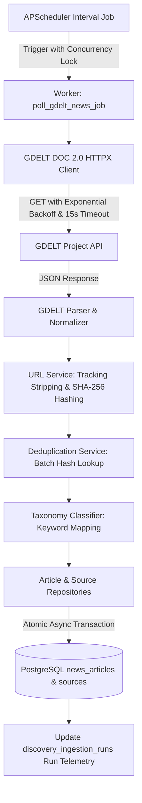

# MetroScope GDELT Ingestion Pipeline Documentation

**Version:** 1.0.0 (Phase 2)  
**Provider:** GDELT DOC 2.0 API (`https://api.gdeltproject.org/api/v2/doc/doc`)  
**Format:** JSON (`mode=ArtList&format=json`)  
**Worker Engine:** Python Async Worker with APScheduler  

---

## 1. Architectural Overview



---

## 2. Ingestion Workflow Step-by-Step

### Step 1: Concurrency-Protected Job Invocation
The worker triggers `poll_gdelt_news_job` on an interval configured by `GDELT_POLL_INTERVAL_MINUTES` (default: 15 minutes). An in-process `asyncio.Lock` ensures that if a cycle experiences network delays, overlapping concurrent runs are automatically skipped.

### Step 2: Ingestion Run Initialization
A tracking record is created in `discovery_ingestion_runs` with `provider="gdelt"` and `status="running"`.

### Step 3: Upstream Querying with Fault Tolerance
- **Endpoint:** `https://api.gdeltproject.org/api/v2/doc/doc`
- **Query Parameters:**
  - `query`: Default `"sourcecountry:US"` (filters discovery to verified US publishers).
  - `mode`: `"ArtList"`
  - `maxrecords`: `50` (bounded to preserve memory and respect upstream limits).
  - `format`: `"json"`
  - `sort`: `"DateDesc"`
- **Client Resilience:**
  - Configured with HTTPX asynchronous transport.
  - Connection timeout: 10s; read timeout: 15s.
  - Exponential retry backoff on upstream 5xx/429 errors (up to 3 attempts with jitter).
  - Rate limiting minimum delay between requests (5 seconds).

### Step 4: Upstream Response Parsing & Date Conversion
GDELT timestamps (format `YYYYMMDDTHHMMSSZ`, e.g. `20261107T120000Z`) are parsed into timezone-aware UTC `datetime.datetime` objects. Empty or malformed records are safely skipped with debug telemetry.

### Step 5: Canonical URL Normalization & Hashing
To prevent duplicate records from different query parameters or tracking tags:
1. Strip tracking query parameters: `utm_*`, `fbclid`, `gclid`, `ref`, `source`, `campaign`.
2. Lowercase URL scheme and hostname.
3. Remove trailing slashes and URL fragments (`#`).
4. Alphabetically sort remaining significant query parameters.
5. Compute **SHA-256 hex digest** (64 characters) on the canonical URL.

### Step 6: Batch Deduplication
Before executing article inserts, the pipeline extracts all candidate hashes and performs a single database lookup:
```sql
SELECT canonical_url_hash FROM news_articles WHERE canonical_url_hash IN (...)
```
Any candidate already existing in the database is counted as `duplicate_count` and omitted from insertion.

### Step 7: Editorial Categorization
Articles are classified into one of the 10 editorial taxonomy desks:
- Technology, Business, Politics, Science, Health, Environment, Sports, Entertainment, World, US.
Classification is based on high-precision keyword patterns matching title and snippet text. If an article belongs to a US publisher without a specific desk match, it defaults to the `US` desk.

### Step 8: Publisher Extraction & Storage
The publisher domain is resolved via `extract_domain(canonical_url)`. A `NewsSource` record is fetched or created on-demand with domain-level uniqueness.

### Step 9: Atomic Insertion & Telemetry Update
The batch of new `NewsArticle` objects is committed within an async database transaction. Upon completion, the `discovery_ingestion_run` record is updated with:
- `completed_at`
- `status` (`success`, `partial`, or `failed`)
- `fetched_count`, `inserted_count`, `duplicate_count`, `failed_count`

---

## 3. Copyright Safeguards & Publisher Attribution

MetroScope adheres to strict digital news copyright standards:

1. **No Full-Text Scraping:** The platform never crawls, scrapes, or stores third-party publisher article bodies.
2. **Metadata & Factual Summaries Only:** Only factual headlines, publication timestamps, category taxonomy, and brief discovery snippets are stored.
3. **No Image Duplication:** Full publisher image files are not downloaded or copied to disk.
4. **Direct Publisher Attribution:** Every article record prominently credits the original publishing domain and provides a direct hyperlink to the original publisher URL.
