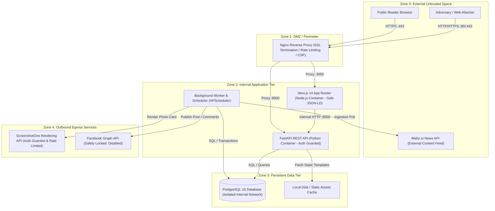

# MetroScope — Threat Model & Attack Surface Analysis

**Version:** 2.0 (Post-Remediation Verification)  
**Target:** MetroScope News Aggregation & Publication Platform  
**Target Environment:** AWS EC2 / Docker Compose / Next.js 14 / FastAPI / PostgreSQL  
**Domain:** `themetroscope.com`  
**Date:** November 2026  
**Status:** Remediated & Verified  

---

## 1. System Architecture & Component Diagram

MetroScope ingests news articles from third-party APIs (Webz.io), processes and filters editorial content, generates branded social graphics via ScreenshotOne API, publishes to the Facebook Graph API, and serves public web readers via a Next.js frontend and FastAPI backend.

---

## 2. Trust Boundaries

MetroScope is divided across five distinct trust boundaries:

| Boundary ID | Description | Source | Destination | Protocol / Auth | Status |
| :--- | :--- | :--- | :--- | :--- | :---: |
| **TB-01** | Internet-to-Perimeter | Public Web / Untrusted Users | Nginx Reverse Proxy | HTTPS :443 / TLS 1.2+ (CSP Enforced) | **Secured** |
| **TB-02** | Perimeter-to-Frontend | Nginx Proxy | Next.js Server Container | HTTP :3000 (Internal Docker Network) | **Secured** |
| **TB-03** | Perimeter-to-Backend | Nginx Proxy | FastAPI REST Service | HTTP :8000 (Internal Docker Network + TrustedHostMiddleware) | **Secured** |
| **TB-04** | Application-to-Data | Backend & Worker Containers | PostgreSQL Database | TCP :5432 (Internal `metroscope_net` only, host port removed/loopback) | **Secured** |
| **TB-05** | Egress-to-Third-Party | Ingestion Worker / Social Publisher | Webz.io / ScreenshotOne / Facebook | Outbound HTTPS :443 (Bearer Tokens, Operator Auth, Safety Locks) | **Secured** |

---

## 3. Attack Surfaces

### 3.1 Public Ingress Attack Surface (TB-01 / TB-02 / TB-03)
- **Public Next.js Web Routes:**
  - `GET /` (Homepage)
  - `GET /article/[slug]` (Article detail view & sanitized JSON-LD injection via `safeJsonLd()`)
  - `GET /category/[slug]` (Category listing view & sanitized JSON-LD injection)
  - `GET /search?q=...` (Client-side search execution)
  - `GET /privacy`, `/terms`, `/about`, `/editorial-standards`
- **Public Backend API Endpoints:**
  - `GET /api/v1/articles` (Public article filtering and bounded `ILIKE` search: 2–100 chars)
  - `GET /api/v1/articles/{id_or_slug}` (Public article retrieval)
  - `GET /api/v1/categories` (Category metadata listing)
  - `POST /api/v1/newsletter/subscribe` (Email subscription endpoint)
  - `GET /health`, `/health/ready` (Public service liveness probes)
- **Protected Operator Endpoints (Now Guarded by `verify_operator_auth` & Rate Limiting):**
  - `GET /health/ops` (**Secured**: Requires operator Bearer / `X-Operator-Key`)
  - `GET /api/v1/social/facebook/status` (**Secured**: Requires operator Bearer / `X-Operator-Key`)
  - `GET /api/v1/photo-cards/articles/{article_id}/render` (**Secured**: Requires operator Bearer / `X-Operator-Key` + IP rate limit 30 req/min)

### 3.2 Upstream Content Ingress (TB-05)
- **Webz.io API Responses:**
  - Ingested article titles, summaries, text bodies, author names, publisher domain names, published timestamps, and image URLs.
  - **Mitigation Implemented:** Strict regex validation (`HTML_INJECTION_PATTERN`) rejects ``, `<svg>`, ``, `<iframe>`, and event handler injections (`onload=`, `onerror=`) across title, summary, body, and publisher fields, while safely preserving standard punctuation and mathematical inequality symbols.

### 3.3 Network & Host Surface (TB-04)
- **Docker Daemon & Host Port Bindings:**
  - `docker-compose.yml`: Database port 5432 bound strictly to loopback interface `127.0.0.1:${POSTGRES_PORT:-5432}:5432`.
  - `docker-compose.prod.yml`: Database host port mapping completely removed (`ports:` absent). Database accessible exclusively within internal Docker bridge network `metroscope_net`.
  - Host AWS EC2 instance metadata service protected via IMDSv2 token enforcement.

---

## 4. Threat Actor Profiles

| Threat Actor | Capabilities | Motivation | Target Assets | Status Post-Remediation |
| :--- | :--- | :--- | :--- | :---: |
| **External Anonymous Attacker** | Web exploit tools, automated fuzzers, headless browsers, botnets | Financial gain, site defacement, malware distribution, SEO hijacking | Reader browsers (via XSS), database availability, API credentials | **Neutralized:** XSS sanitized, search input bounded, CSP enforced |
| **Malicious Upstream Content Provider** | Controlled publisher domain, manipulated RSS feeds, poisoned news articles | Reputational sabotage, stored payload delivery, SEO poisoning | Next.js DOM, backend ingestion parser, Photo Card rendering engine | **Neutralized:** Multi-field HTML injection validation in place |
| **Resource Exhaustion Attacker** | High-concurrency HTTP flooders, scriptable scrapers | Disrupt service, cause financial harm via API billing exhaustion | ScreenshotOne API quota, Webz.io quota, PostgreSQL connection pool | **Neutralized:** ScreenshotOne operator auth + 30 req/min rate limit |
| **Opportunistic Network Scanner** | Shodan, Censys, mass port scanners (`masscan`, `zmap`) | Discover exposed databases and default credentials | PostgreSQL port 5432, unauthenticated health/debug endpoints | **Neutralized:** DB port exposure eliminated; telemetry authenticated |

---

## 5. Asset Classification

| Asset | Sensitivity | Integrity Impact | Confidentiality Impact | Availability Impact | Remediation Status |
| :--- | :---: | :---: | :---: | :---: | :---: |
| **Visitor Session & Browser DOM** | High | High (Malware execution) | High (Cookie/token theft) | Medium | **Protected** (VULN-01, VULN-10) |
| **PostgreSQL Database Records** | Critical | High (Article tampering) | Medium (Published news is public) | Critical (Database outage) | **Protected** (VULN-03, VULN-07) |
| **ScreenshotOne API Keys & Quota** | High | Medium (Render distortion) | High (Quota theft) | High (Billing exhaustion) | **Protected** (VULN-02) |
| **Facebook Graph API Access Token** | Critical | Critical (Unauthorized posting) | High (Private page token) | High (Page bans) | **Protected** (VULN-04, VULN-05) |
| **Webz.io News API Key & Quota** | High | Low | High | High (Ingestion freeze) | **Protected** (VULN-04) |
| **Server Host & Docker Environment** | Critical | Critical (Full host takeover) | Critical (Secrets dump) | Critical (Host destruction) | **Protected** (VULN-03, VULN-08) |

---

## 6. STRIDE Threat Analysis & Post-Remediation Status

### 6.1 Spoofing (Identity)
- **Threat:** An attacker spoofs the internal operator token to trigger unauthorized actions or Facebook posts.
- **Vulnerability:** `SECRET_KEY` in `config.py` defaulted to `"metroscope_secret_key_default_salt"`, which was accepted by `verify_operator_auth`.
- **Implemented Mitigation:** `verify_operator_auth` explicitly rejects `"metroscope_secret_key_default_salt"` when `ENVIRONMENT == "production"`. Added dedicated `OPERATOR_API_KEY` setting. Documented production secret generation in `.env.example`.
- **Status:** **Mitigated & Verified** (TC-SEC-05).

### 6.2 Tampering (Data Integrity)
- **Threat:** An upstream news source injects malicious HTML tags into headlines or summaries to execute arbitrary JavaScript in reader browsers.
- **Vulnerability:** Next.js JSON-LD generation used unescaped `JSON.stringify()`; backend `validate_title` only checked for `"` injection | **8.8** (Critical) | **1.2** (Negligible) | **Resolved** | Frontend `safeJsonLd()` + Backend `HTML_INJECTION_PATTERN` |
| **T-02** | ScreenshotOne API Quota / Financial Exhaustion | **8.4** (High) | **1.8** (Low) | **Resolved** | Operator Auth + IP Rate Limiter (30 req/min) |
| **T-03** | PostgreSQL Direct Port Exposure to Internet | **8.2** (High) | **1.0** (Negligible) | **Resolved** | Loopback binding (`127.0.0.1`) + Prod port removal |
| **T-04** | Operational Telemetry & Quota Status Leak | **7.6** (High) | **1.4** (Low) | **Resolved** | `verify_operator_auth` on `/health/ops` & `/social/facebook/status` |
| **T-05** | Fallback Default `SECRET_KEY` Operator Auth Bypass | **7.2** (Medium) | **1.2** (Negligible) | **Resolved** | Default salt rejection in prod + `OPERATOR_API_KEY` |
| **T-06** | TOCTOU DNS Rebinding SSRF on Image Fetching | **5.8** (Medium) | **3.2** (Low) | **Tracked / Mitigated** | Private IP range check + IMDSv2 deployment guidance |
| **T-07** | Database DoS via Unanchored `ILIKE` Search Flooding | **7.0** (Medium) | **2.6** (Low) | **Mitigated** | Query bounds (`min_length=2`, `max_length=100`) on search API |
| **T-08** | Production Outage via `ALLOWED_HOSTS` Misconfiguration | **9.0** (Blocker) | **1.0** (Negligible) | **Resolved** | Domain aligned to `themetroscope.com` across all configs |

*(Scale: 1 = Lowest, 10 = Highest; D=Damage, R=Reproducibility, E=Exploitability, A=Affected Users, D=Discoverability)*
